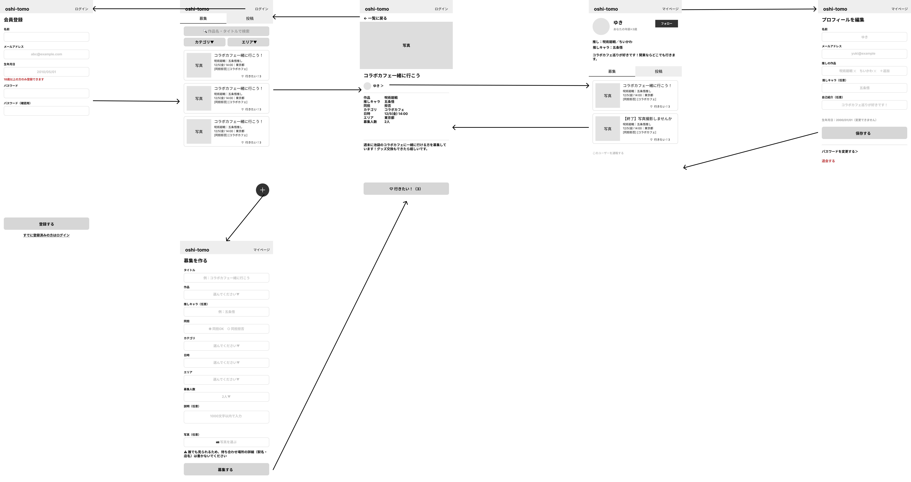

# 画面設計（Figma）

## Figma の URL（閲覧用の共有リンク）

https://www.figma.com/design/Tku4M3QKBPlf8cIJ8SJPN7/oshi-tomo-%E7%94%BB%E9%9D%A2%E8%A8%AD%E8%A8%88?node-id=14-602&t=ytfOgcBFLJ78UEjM-1

| ページ | 内容 |
|--------|------|
| 画面設計 | 主要画面のワイヤーフレーム（6画面） |
| 画面遷移図 | 6画面を矢印でつないだ図。画像版は [screen-transition.png](screen-transition.png) |

## 設計の方針

- **ワイヤーフレーム**（白黒・枠のみ）で、レイアウトと画面の構造を確認する。色・フォントなどのデザインは実装時に決める
- **スマートフォンを主に考える**。推し活の利用者は、移動中や現地でスマートフォンから使うことが多いため
  - フレームのサイズは iPhone 16（393×852）
  - PC で開いたときは、スマートフォンの画面幅のまま中央に表示する（レスポンシブ対応は Tailwind CSS で行う）
- ヘッダーは全画面共通。ログインしていないときは「ログイン」、ログインしているときは「マイページ」を表示する

## 画面一覧

| No | 画面 | ルート（[routing.md](../03_routing-design/routing.md)） | 主な機能 | 優先度 | MVP |
|----|------|------------------------------------------------------|---------|--------|-----|
| 01 | 募集一覧（トップ） | GET /recruitments（recruitments.index） | F-03, F-05 | Must | ✅（検索はキーワードのみ） |
| 02 | 募集詳細 | GET /recruitments/{recruitment}（recruitments.show） | F-03, F-07, F-08 | Must | ✅ |
| 03 | 募集作成 | GET /recruitments/create（recruitments.create）。編集（recruitments.edit）も同じレイアウト | F-03, F-06 | Must | ✅ |
| 04 | プロフィール | GET /users/{user}（users.show） | F-02, F-14, F-15 | Must | |
| 05 | プロフィール編集 | GET /profile（profile.edit） | F-02, F-09 | Must | |
| 06 | 会員登録 | GET /register（register） | F-01 | Must | ✅ |

- 06 は Week 21 で追加した。Breeze の会員登録画面に「生年月日」の欄を足すため、そのままの画面ではなくなるから
- 01 のカテゴリ・エリアの絞り込みは MVP の後に作る。MVP では検索欄（キーワード）だけ動くようにする

### 各画面で表している状態

| No | 画面 | 状態 |
|----|------|------|
| 01 | 募集一覧 | ログインしていない人が見ている |
| 02 | 募集詳細 | ログインしていない人が、他の人の募集を見ている |
| 03 | 募集作成 | ログインしている人が、新しく募集を作る |
| 04 | プロフィール | ログインしている人が、他の人のプロフィールを見ている（年齢の範囲・フォローボタンを表示） |
| 05 | プロフィール編集 | ログインしている人が、自分のプロフィールを編集する |
| 06 | 会員登録 | ログインしていない人が、18歳未満の生年月日を入力して「登録する」を押した（エラーを表示） |

## 画面遷移

| No | どの画面の | 何を押すと | どの画面へ |
|----|-----------|-----------|-----------|
| 1 | 01 募集一覧 | 募集カード | 02 募集詳細 |
| 2 | 01 募集一覧 | ＋ボタン | 03 募集作成（ログインしていなければログイン画面へ） |
| 3 | 02 募集詳細 | ← 一覧に戻る | 01 募集一覧 |
| 4 | 02 募集詳細 | 募集した人（ゆき ＞） | 04 プロフィール |
| 5 | 03 募集作成 | 募集する | 02 募集詳細（保存した募集） |
| 6 | 04 プロフィール | 募集カード | 02 募集詳細 |
| 7 | 04 プロフィール | マイページ（自分のプロフィールのとき「編集する」） | 05 プロフィール編集 |
| 8 | 05 プロフィール編集 | 保存する | 04 プロフィール |
| 9 | 01 募集一覧 | ヘッダーの「ログイン」→ ログイン画面の「新規登録」 | 06 会員登録（ログイン画面は Breeze のものを使うため描いていない） |
| 10 | 06 会員登録 | 登録する | 01 募集一覧（Breeze の `/dashboard` ではなく募集一覧へ） |

図に書いていないルール
- どの画面からも、ヘッダーの「oshi-tomo」で 01 募集一覧へ、「マイページ」で自分のプロフィールへ移動できる
- 「ログイン」を押すと、Breeze のログイン画面へ移動する

## ワイヤーフレームに描いていない状態

画面の数が多くなるため、次の状態は文章で決めておき、Week 21 の見直しで必要なものを Figma に追加する。

| 画面 | 状態 | 表示 |
|------|------|------|
| 02 募集詳細 | 自分の募集を見ているとき | 「行きたい！」ボタンの代わりに「編集する」「削除する」ボタンを表示。「行きたい！」を押した人の一覧（F-08）を表示 |
| 02 募集詳細 | ログインしていないとき | 「行きたい！」ボタンの代わりに「ログインして『行きたい！』を押す」を表示 |
| 02 募集詳細 | 「行きたい！」を押した後 | ボタンが「♥ 行きたい！済み（4）」に変わる（ページの再読み込みなし） |
| 04 プロフィール | 自分のプロフィールのとき | フォローボタン・通報リンクの代わりに「プロフィールを編集する」ボタンを表示 |
| 04 プロフィール | ログインしていないとき | 年齢の範囲・フォローボタン・相手との関係を表示しない |

## 画面設計チェックリスト（教材）

| チェック項目 | 対応 |
|-------------|------|
| ユーザー導線が明確か | 募集一覧 → 詳細 → プロフィール、募集一覧 → 作成 → 詳細 の流れを画面遷移図で確認した |
| 必要な情報が揃っているか | 要件定義書の「募集の項目」（推しキャラ・同担を含む）をすべて 02・03 に入れた |
| ボタン配置は適切か | 一番押してほしいボタン（行きたい！・募集する・保存する）を、画面の下に横幅いっぱいで配置した。募集を作る＋ボタンは、スクロールしても押せる右下に置く |
| レスポンシブ対応を考慮したか | スマートフォンを主にして設計し、PC では中央に表示する方針にした |
| アクセシビリティに配慮したか | 入力欄には必ず項目名（ラベル）を付けた。退会は赤字にして、危険な操作だと分かるようにした。実装時に文字と背景のコントラストを確認する |
| エラー表示を設計したか | 入力エラーは、各入力欄のすぐ下に赤字で表示する（Breeze の表示と同じ形）。18歳未満の登録エラーも同じ |
| ローディング状態を考慮したか | 「行きたい！」・フォロー（Ajax）は、通信中はボタンを押せないようにして二重送信を防ぐ |

## 今回作っていない画面（Week 21 で確定）

| 画面 | 理由 |
|------|------|
| ログイン・パスワード再設定 | Breeze の画面をそのまま使う（会員登録は 06 として追加した） |
| エラーページ（404 など） | Laravel の標準のエラーページを使う |
| 公式情報の一覧・お問い合わせ | Could のため。お問い合わせは 03 と同じフォームのレイアウトで作る |
| 投稿一覧・投稿詳細・投稿作成 | Should のため。募集の画面（01〜03）と同じレイアウトで作る |
| 通報フォーム | Could のため |
