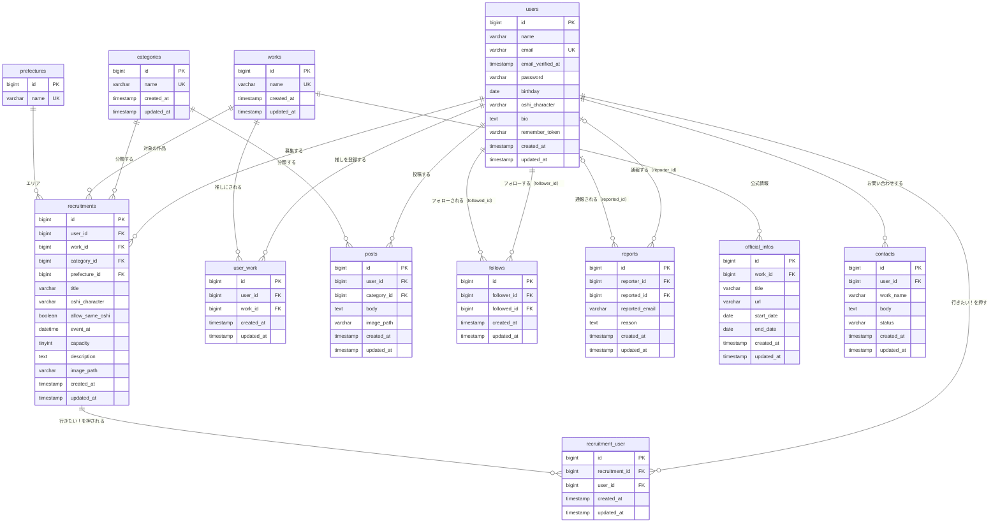

# ER図

oshi-tomo の ER図です。各テーブルのカラムの詳細は [table-definitions.md](table-definitions.md) を参照してください。
画像版は [er-diagram.png](er-diagram.png) です（この Mermaid を Mermaid Live Editor で書き出したもの）。

## 記号の読み方（カラスの足記法）

| 記号 | 意味 |
|------|------|
| `\|\|` | ちょうど1つ |
| `o\|` | 0か1つ |
| `o{` | 0以上 |

例：`users ||--o{ recruitments` は「1人のユーザーは、0個以上の募集を持つ」

## ER図

## 多対多の関係（中間テーブル）

| 関係 | 中間テーブル |
|------|-------------|
| users ⇔ recruitments（行きたい！） | recruitment_user |
| users ⇔ works（推しの作品） | user_work |
| users ⇔ users（フォロー） | follows |
