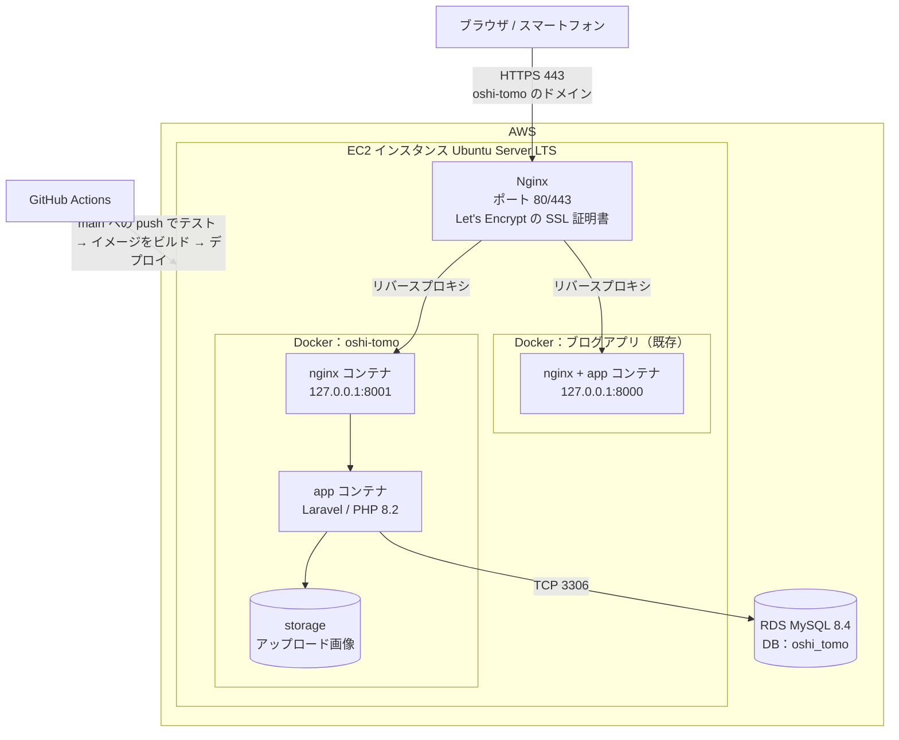
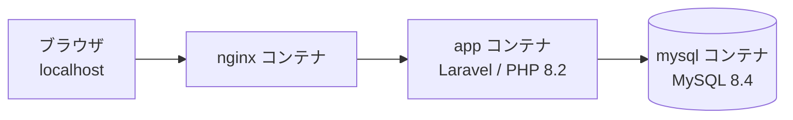

# インフラ構成図

## デプロイ先

**A：AWS を使い続ける**

Week 11〜17 でブログアプリ（rabblog.com）用に作った EC2 + Docker + GitHub Actions の構成を、oshi-tomo でも使う。
Week 21 の技術選定で A に確定した（[06_tech-stack.md](../06_tech-stack.md)）。

| 理由 | 内容 |
|------|------|
| 構築済みの環境を使える | EC2・RDS・ドメイン・SSL 証明書・CI/CD が Week 13〜16 で動いている |
| 費用 | AWS の無料プランのクレジットの範囲で運用できる（無料プランは 2027-04-18 まで） |
| データが消えない | B（Render など）と違い、DB の期限や、再デプロイで画像が消える問題がない |

## 本番環境の構成図



### テキスト版

```
【インターネット】
     |
     | HTTPS (443)
     ↓
【ドメイン（Week 13 で取得した rabblog.com のサブドメイン：oshi-tomo.rabblog.com）】
     |
     ↓
【EC2 インスタンス（Ubuntu Server LTS）】
  ├── Nginx（ポート 80/443、Let's Encrypt の SSL 証明書）
  │    ├── oshi-tomo のドメイン → 127.0.0.1:8001
  │    └── rabblog.com（ブログアプリ） → 127.0.0.1:8000
  ├── Docker：ブログアプリ（既存）
  └── Docker：oshi-tomo（docker compose で起動）
       ├── nginx コンテナ（127.0.0.1:8001）
       └── app コンテナ（Laravel / PHP 8.2）
            └── 画像の保存先：storage（ローカル）※ S3 は発展
     |
     | TCP (3306)
     ↓
【RDS（MySQL 8.4）】 ブログアプリと同じ RDS に、oshi-tomo 用のデータベース（oshi_tomo）を作る

【GitHub Actions】── main への push でテスト → イメージをビルド → EC2 にデプロイ
```

## 構成要素

| 要素 | 使うもの | 内容 |
|------|---------|------|
| クライアント | ブラウザ、スマートフォン | スマートフォンからの利用が中心 |
| ドメイン | Week 13 で取得したドメインのサブドメイン | oshi-tomo.rabblog.com（Week 21 で確定） |
| Web サーバー | EC2 の Nginx | HTTPS の終端（Let's Encrypt）。ドメインごとにブログアプリと oshi-tomo へ振り分ける |
| アプリサーバー | EC2 上の Docker（nginx + app コンテナ） | Laravel / PHP 8.2。ブログアプリとはポート（8000 / 8001）とディレクトリを分ける |
| データベース | RDS（MySQL 8.4） | ブログアプリと同じ RDS インスタンスに、別のデータベースとユーザーを作る |
| ストレージ | EC2 の storage（ローカル） | 募集・投稿の写真。S3 + CloudFront はブログアプリで構築済みのため、発展として検討する |
| キャッシュ | なし（最初は使わない） | 利用者が増えて一覧が遅くなったら、ブログアプリと同じく Redis を追加する |
| CI/CD | GitHub Actions | テスト（PHPUnit・PHPStan）→ Docker イメージのビルド → EC2 へデプロイ |
| ネットワーク境界 | VPC、セキュリティグループ | EC2 は 22（SSH）・80・443 だけ開ける。RDS は EC2 のセキュリティグループからの 3306 だけ許可する |

## 開発環境の構成図



- ブログアプリと同じく、Docker Compose で nginx・app・mysql のコンテナを起動する

## 注意点・制約

| 項目 | 内容 |
|------|------|
| EC2 のメモリ | 1台の EC2 でブログアプリと oshi-tomo の2つを動かすため、メモリ不足に注意する。足りなくなったら、ブログアプリのコンテナを止める |
| 費用 | 無料プランのクレジットの範囲で運用する。Week 18〜21 は EC2・RDS を停止して節約する（RDS は停止から7日で自動的に起動するため、確認する） |
| 無料プランの期限 | 2027-04-18 で終わるため、それまでに継続するか、別のサービスへ移すかを決める |
| デプロイの時期 | 最初の提出（12/9）はローカル環境で動く状態にし、本番へのデプロイは提出後に行う（[schedule.md](../04_estimation/schedule.md)） |
