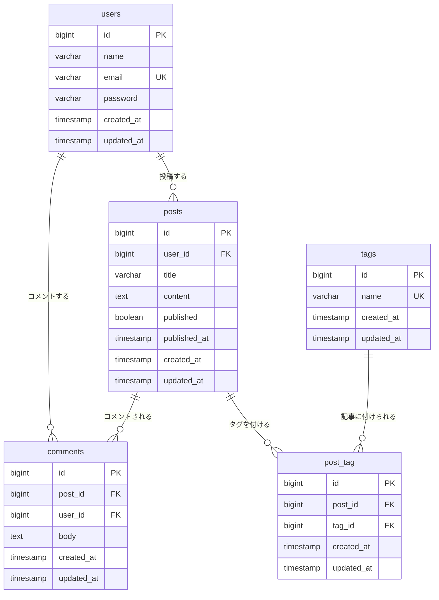

# 練習課題2：ブログシステムの DB設計書

題材：ブログシステム（users・posts・comments・tags）

## 想定する機能

- 会員登録・ログインしたユーザーが、記事を投稿・編集・削除できる
- 記事には、タグを複数付けられる（同じタグを2回は付けない）
- ログインしたユーザーは、記事にコメントできる
- 記事は「下書き」と「公開」を切り替えられる

## テーブル一覧

| No | テーブル名 | 日本語名 | 種類 |
|----|-----------|---------|------|
| 1 | users | ユーザー | メイン |
| 2 | tags | タグ | マスタ |
| 3 | posts | 記事 | メイン |
| 4 | comments | コメント | メイン |
| 5 | post_tag | 記事とタグの関係 | 中間（posts × tags） |

## ER図

## テーブル定義

### 1. users（ユーザー）

| カラム名 | 型 | NULL | デフォルト | 説明 |
|----------|-----|------|-----------|------|
| id | BIGINT UNSIGNED | NO | AUTO | ユーザーID（PK） |
| name | VARCHAR(50) | NO | - | ユーザー名 |
| email | VARCHAR(100) | NO | - | メールアドレス |
| password | VARCHAR(255) | NO | - | パスワード（ハッシュ） |
| created_at | TIMESTAMP | YES | NULL | 作成日時 |
| updated_at | TIMESTAMP | YES | NULL | 更新日時 |

【インデックス】
- PRIMARY KEY (id)
- UNIQUE KEY (email)

【制約】
- email：UNIQUE 制約
- password：8文字以上（バリデーション）

### 2. tags（タグ）

| カラム名 | 型 | NULL | デフォルト | 説明 |
|----------|-----|------|-----------|------|
| id | BIGINT UNSIGNED | NO | AUTO | タグID（PK） |
| name | VARCHAR(30) | NO | - | タグ名 |
| created_at | TIMESTAMP | YES | NULL | 作成日時 |
| updated_at | TIMESTAMP | YES | NULL | 更新日時 |

【インデックス】
- PRIMARY KEY (id)
- UNIQUE KEY (name)：同じ名前のタグを2つ作らない（表記ゆれを防ぐ）

### 3. posts（記事）

| カラム名 | 型 | NULL | デフォルト | 説明 |
|----------|-----|------|-----------|------|
| id | BIGINT UNSIGNED | NO | AUTO | 記事ID（PK） |
| user_id | BIGINT UNSIGNED | NO | - | 投稿したユーザー（FK） |
| title | VARCHAR(200) | NO | - | タイトル |
| content | TEXT | NO | - | 本文 |
| published | BOOLEAN | NO | false | 公開状態（true＝公開、false＝下書き） |
| published_at | TIMESTAMP | YES | NULL | 公開日時（下書きの間は NULL） |
| created_at | TIMESTAMP | YES | NULL | 作成日時 |
| updated_at | TIMESTAMP | YES | NULL | 更新日時 |

【インデックス】
- PRIMARY KEY (id)
- INDEX (published, published_at)：公開中の記事を新しい順に並べるため

【外部キー】
- user_id REFERENCES users(id) ON DELETE CASCADE

### 4. comments（コメント）

| カラム名 | 型 | NULL | デフォルト | 説明 |
|----------|-----|------|-----------|------|
| id | BIGINT UNSIGNED | NO | AUTO | コメントID（PK） |
| post_id | BIGINT UNSIGNED | NO | - | どの記事へのコメントか（FK） |
| user_id | BIGINT UNSIGNED | NO | - | コメントしたユーザー（FK） |
| body | TEXT | NO | - | コメント本文 |
| created_at | TIMESTAMP | YES | NULL | 作成日時 |
| updated_at | TIMESTAMP | YES | NULL | 更新日時 |

【インデックス】
- PRIMARY KEY (id)
- post_id・user_id は外部キーを付けると自動で作成される

【外部キー】
- post_id REFERENCES posts(id) ON DELETE CASCADE：記事を消したら、コメントも消す
- user_id REFERENCES users(id) ON DELETE CASCADE：退会したら、その人のコメントも消す

【制約（バリデーション）】
- body：1000文字以内

### 5. post_tag（記事とタグの関係）

| カラム名 | 型 | NULL | デフォルト | 説明 |
|----------|-----|------|-----------|------|
| id | BIGINT UNSIGNED | NO | AUTO | ID（PK） |
| post_id | BIGINT UNSIGNED | NO | - | 記事（FK） |
| tag_id | BIGINT UNSIGNED | NO | - | タグ（FK） |
| created_at | TIMESTAMP | YES | NULL | 作成日時 |
| updated_at | TIMESTAMP | YES | NULL | 更新日時 |

【インデックス】
- PRIMARY KEY (id)
- UNIQUE KEY (post_id, tag_id)：1つの記事に同じタグを2回付けない

【外部キー】
- post_id REFERENCES posts(id) ON DELETE CASCADE
- tag_id REFERENCES tags(id) ON DELETE CASCADE：タグを消したら、記事との関係だけ消える（記事は残る）

## 設計のポイント

| ポイント | 内容 |
|---------|------|
| 多対多は中間テーブル | 記事とタグは「1つの記事に複数のタグ」「1つのタグが複数の記事に」の多対多のため、中間テーブル post_tag を作る |
| 中間テーブルの名前 | Laravel の命名ルール（単数形をアルファベット順に `_` でつなぐ）に合わせると、`belongsToMany` でテーブル名を省略できる |
| 正規化 | タグ名を posts に文字列（例：「PHP,Laravel」）で持たず、tags テーブルに分ける。タグ名を変えたいときに1か所の修正で済み、タグで検索もしやすい |
| 組み合わせの UNIQUE | post_tag は (post_id, tag_id) の組み合わせに UNIQUE を付ける。片方だけに付けると「1つの記事にタグ1つだけ」になってしまう |
| ON DELETE | 記事・ユーザーが消えたら、その記事のコメントや関係も意味がなくなるため CASCADE にする |
