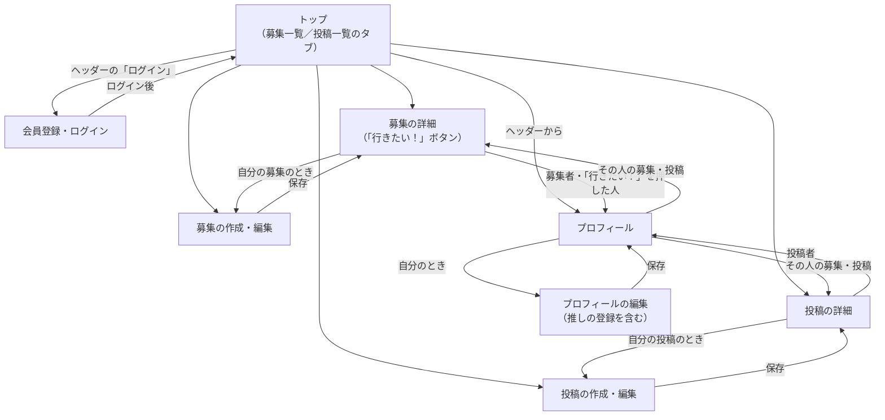

# oshi-tomo 要件定義書（初版）

## 1. プロジェクト概要

### 背景
推し活では、コラボカフェや写真撮影など「誰かと一緒に行きたい」場面が多い。
しかし既存のサービス（X、ふぁぼま など）では、知らない人と会うのが怖く、
気が合う相手かどうかも事前に分かりにくい。

### 目的
推しや好きな活動が合う仲間を、安心して見つけられるようにする。

### ターゲットユーザー（ペルソナ）

募集には「募集する人」と「募集を探して参加する人」がいるため、それぞれ1名ずつ作った。

**ペルソナA：募集する人**

| 項目 | 内容 |
|---|---|
| 基本情報 | さくら（仮）、24歳、会社員。平日は仕事で、通勤中にスマホで推しの情報を見ている。推し活は休日にしている |
| 課題・ニーズ | コラボカフェに行きたいけど、1人だと入りにくい。周りに同じ推しの友達がいない。X で募集しても、他の投稿に埋もれてしまう |
| ゴール | 推しの名前を書いて募集を出したら、一緒に行きたい人が気軽に反応してくれる |
| このペルソナから決まること | 募集の投稿（F-03）、写真（F-06）、「行きたい！」（F-07）を Must にする。スマホで見やすい画面にする |

**ペルソナB：募集を探す人**

| 項目 | 内容 |
|---|---|
| 基本情報 | みお（仮）、20歳、大学生。人見知りで、知らない人に DM を送るのが苦手 |
| 課題・ニーズ | 同じ推しの人と出かけたいけど、自分から話しかけるのはハードルが高い。相手がどんな人か分からず不安 |
| ゴール | 推しの名前で募集を探して、ボタン1つで「行きたい」と伝えられる |
| このペルソナから決まること | 検索（F-05）、ボタンだけで参加希望を伝える「行きたい！」（F-07）を Must にする。相手を知るためのプロフィール（F-02）は大事だが、MVP の後でもよい |

### スコープ
- 対象：推し活のおでかけ仲間を探している人
- 作るもの：募集の投稿・検索、「行きたい！」での参加希望、プロフィール、推し活の投稿
- 作らないもの：チャット機能、管理者画面、スマホアプリ（Web アプリのみ）

### MVP（最初にリリースする範囲）

Must のうち、Week 22〜23（最初の提出 12/9 まで）に作る範囲を MVP とする。総合プロジェクトの「必須の機能」は、すべて MVP に入れる。

| 機能 | 優先度 | MVP | 必須の機能 |
|---|---|---|---|
| F-01 会員登録・ログイン・ログアウト（18歳以上） | Must | ✅ | ログイン・ログアウト（Breeze） |
| F-03 募集の投稿・一覧・詳細・編集・削除 | Must | ✅ | 主要なデータの CRUD |
| F-04 自分の募集だけ編集・削除できる | Must | ✅ | 権限管理（Policy） |
| F-05 募集の検索 | Must | ✅ キーワード検索のみ | 検索または絞り込み |
| F-06 募集への写真アップロード | Must | ✅ | 画像アップロード |
| F-07 「行きたい！」ボタン | Must | ✅ | Ajax の操作 |
| F-02 プロフィール（表示・編集） | Must | ❌ | - |

- **F-05 はキーワード検索だけを MVP にする**：必須の機能は「検索または絞り込み」のため、キーワード検索で満たせる。作品・カテゴリ・エリアの絞り込みは MVP の後に作る
- **F-02 は Must だが MVP の外にする**：必須の機能ではなく、なくても「募集する → 探す → 『行きたい！』を押す」の流れは使えるため。名前・メールアドレス・パスワードの変更は、Breeze に最初から付いているプロフィール編集画面でできる。MVP が予定より早く終わったら、最初に F-02 に取り組む
- MVP の後は、F-02 → F-05 の絞り込み → 本番環境へのデプロイ → Should → Could の順に進める

## 2. 現状分析

### 2-1. 現状の流れ（推し活仲間を探して出かけるまで）

1. X で、コラボカフェなどの情報を知る
2. 一緒に行く人を探す
   - X で「同行者募集」と投稿する、または他の人の募集を探す
   - ふぁぼまで、同じ推しの人を探す
3. 気になる相手のプロフィールや過去の投稿を見る
4. 相手に話しかける
   - X：DM を送る
   - ふぁぼま：「ともりく」で申請し、承認されたらメッセージできる
5. 日時や待ち合わせ場所を決めて、当日一緒に出かける

### 2-2. 今使っているサービスの良いところ・課題

**ふぁぼま**

| 良いところ | 課題 |
|---|---|
| 本人確認があり、安心できる | 「ともりく」は1日3回まで無料で、それ以上は課金が必要 |
| 相手の年齢がはっきり出ず、「自分の年齢から±何歳」の範囲で分かる | 画面が切り替わるたびに広告が出て、ストレスになる（課金すると消える） |
| 承認されてからメッセージできる | 自分から話しかけないといけないので、手間がかかる |

**X**

| 良いところ | 課題 |
|---|---|
| 公式の情報が早く届く | 推し活以外の投稿も多く、募集が埋もれて見つけにくい |
| | 相手がどんな人か分かる情報が少なく、知らない人と会うのが怖い |
| | 知らない人にいきなり DM を送るのは、ハードルがとても高い |

### 2-3. 課題のまとめ

- 気が合う相手かどうか、事前に分かりにくい
- 知らない人と会うのが不安
- 話しかけるまでの手間や回数制限があり、気軽に誘えない

## 3. システム概要

### 3-1. システム構成図

（Week 19 の設計で詳しくする。ここでは全体像のみ）

```
[ユーザー（スマホ・PC のブラウザ）]
            │ HTTPS
            ▼
[Web サーバー（Nginx）]
            │
            ▼
[アプリ（Laravel / Blade）]
     │               │
     ▼               ▼
[データベース]     [画像の保存先]
 （MySQL）        （ローカル。発展で S3）
```

- 開発環境：Docker（Week 6〜17 と同じ構成）
- 本番環境：AWS（EC2・RDS）を予定

### 3-2. 主要機能一覧と、解決する課題

| 機能のまとまり | 主な機能 | 解決する課題（2-3 より） |
|---|---|---|
| プロフィール | 推し・好きな活動・年齢の範囲を表示 | 気が合う相手かどうか、事前に分かりにくい |
| 募集 | おでかけ・グッズ交換の募集を投稿、検索・絞り込み | X では募集が埋もれて見つけにくい |
| 「行きたい！」 | ボタン1つで参加希望を伝える | いきなり DM を送るのはハードルが高い／回数制限や課金がある |
| 投稿 | 推し活の記録を投稿・閲覧 | 相手がどんな人か分かる情報が少なく、会うのが不安 |
| フォロー | 相互フォローで「友達」と表示 | 知らない人と会うのが不安（一度会った安心できる人と、また出かけやすくする） |

## 4. 機能要件

### 4-1. ユーザーストーリー

**登場人物**
- **未ログインユーザー**：まだ登録していない人
- **会員ユーザー**：ログインしている人
- **募集者**：募集を投稿した会員ユーザー
- **運営者**：アプリを運営する人（自分）

| No | 誰が | 何をしたい | なぜなら | 優先度 | MVP |
|---|---|---|---|---|---|
| US-01 | 未ログインユーザー | 会員登録・ログインしたい | 募集の投稿や参加希望をするため | Must | ✅ |
| US-02 | 会員ユーザー | 自分の推し・好きな活動をプロフィールに書きたい | 気が合う人かどうか相手に判断してもらうため | Must | |
| US-03 | 会員ユーザー | 他の人のプロフィールを見たい | 会う前にどんな人か知って安心したいから | Must | |
| US-04 | 募集者 | おでかけの募集を投稿したい | 一緒にコラボカフェや撮影に行く仲間が欲しいから | Must | ✅ |
| US-05 | 募集者 | 募集に写真を付けたい | どんなおでかけか伝わりやすくするため | Must | ✅ |
| US-06 | 募集者 | 自分の募集を編集・削除したい | 予定が変わったり、仲間が見つかったりしたときに直すため | Must | ✅ |
| US-07 | 会員ユーザー | 募集の一覧を見たい | どんなおでかけがあるか知りたいから | Must | ✅ |
| US-08 | 会員ユーザー | 推しの名前で募集を検索したい | 同じ推しの人とだけ行きたいから | Must | ✅ |
| US-09 | 会員ユーザー | カテゴリやエリアで絞り込みたい | 行ける場所・やりたいことに合う募集を探したいから | Must | |
| US-10 | 会員ユーザー | 「行きたい！」ボタンで参加希望を伝えたい | 気軽に声をかけたいから | Must | ✅ |
| US-11 | 募集者 | 誰が「行きたい！」を押したか見たい | 一緒に行く相手を選ぶため | Should | |
| US-12 | 会員ユーザー | 迷惑なユーザーを通報したい | 安心して使えるようにするため | Could | |
| US-13 | 会員ユーザー | 自分の推し・作品を登録したい | 同じ推しの人や募集を見つけやすくするため | Should | |
| US-14 | 会員ユーザー | コラボカフェなどの公式情報を見たい | 募集を立てるきっかけにしたいから | Could | |
| US-15 | 会員ユーザー | 載せてほしい作品をお問い合わせで送りたい | 自分の推しの作品も扱ってほしいから | Could | |
| US-16 | 会員ユーザー | 推し活の記録を投稿したい（写真は付けても付けなくてもよい） | 自分の推し活を残して、好みを知ってもらうため | Should | |
| US-17 | 会員ユーザー | 他の人の投稿を見たい | 会う前に気が合いそうか判断したいから | Should | |
| US-18 | 会員ユーザー | ランダムグッズの交換相手を募集したい | 欲しいキャラのグッズを手に入れたいから | Must | ✅ |
| US-19 | 会員ユーザー | 相手の年齢が自分と近いかを知りたい（正確な年齢は知られたくない） | 年齢の近い人のほうが安心して会えるから | Could | |
| US-20 | 会員ユーザー | 気になる人をフォローしたい | また一緒に出かけたい人とつながっておくため | Could | |
| US-21 | 会員ユーザー | 相手との関係（友達・フォロー中・フォローされています）を見たい | 安心して誘える相手かどうか分かるから | Could | |
| US-22 | 運営者 | 18歳未満の人が会員登録できないようにしたい | 知らない人と会うアプリなので、未成年がトラブルに巻き込まれるのを防ぐため | Must | ✅ |

### 4-1-2. 受け入れ基準

ユーザーストーリーごとに「これができたら完成」と判断する条件。GitHub Issues（#3〜#18）の「受け入れ条件」と同じ内容にしている。

**US-01・US-22：18歳以上の人だけ会員登録・ログインできる（Must・MVP）**
- 生年月日（必須）を入力して会員登録できる
- 登録日時点で18歳未満の生年月日では、エラーメッセージが表示されて登録できない
- 生年月日は他のユーザーに表示されない
- ログイン・ログアウトできる

**US-07：募集の一覧・詳細を見る（Must・MVP）**
- ログインしていなくても、募集の一覧・詳細を見られる
- 一覧は新しく投稿された順に並ぶ
- 日時が過ぎた募集は、トップの一覧に表示されない
- 一覧から詳細へ移動できる

**US-04・US-18：おでかけ・グッズ交換の募集を投稿する（Must・MVP）**
- ログインした人だけが募集を作成できる
- タイトル・作品・推しキャラ・同担・カテゴリ・日時・エリア・募集人数・説明を入力できる
- 入力が正しくないとき（必須が空、文字数オーバー、過去の日時、人数が1〜10人以外）はエラーメッセージが表示される
- グッズ交換は、カテゴリ「グッズ」で募集できる
- 作成画面に「待ち合わせ場所の詳細（駅名・店名）は書かないでください」と表示される

**US-06：自分の募集だけ編集・削除できる（Must・MVP）**
- 自分の募集を編集・削除できる
- 他の人の募集には、編集・削除ボタンが表示されない
- 他の人の募集の編集・削除の URL に直接アクセスしても、403 になる（Policy）

**US-05：募集に写真を付ける（Must・MVP）**
- 募集の作成・編集で、写真を1枚付けられる（任意）
- 画像以外のファイルや、大きすぎるファイルはエラーになる
- 募集の詳細に写真が表示される

**US-10：「行きたい！」ボタンで参加希望を伝える（Must・MVP）**
- ページを再読み込みせずに「行きたい！」を押す・取り消すができる（Ajax）
- 押された数が表示される
- 自分の募集には押せない
- ログインしていない人には押せない

**US-08：推しの名前で募集を検索する（Must・MVP）**
- キーワード（推しキャラ・タイトル）で募集を検索できる

**US-09：カテゴリ・エリアで絞り込む（Must）**
- 作品・カテゴリ・エリアで絞り込める
- キーワード検索と絞り込みを組み合わせられる

**US-02・US-03：プロフィールを書く・見る（Must）**
- 自分のプロフィールを編集できる
- 他の人のプロフィールを見られる
- プロフィールに、その人の募集（過去の募集も含む）が表示される
- メールアドレス・生年月日は表示されない

**US-11：「行きたい！」を押した人を見る（Should）**
- 募集した本人だけが、「行きたい！」を押した人の一覧を見られる
- 一覧から、その人のプロフィールへ移動できる

**US-13：推し・作品を登録する（Should）**
- プロフィールの編集で、作品の一覧から推しの作品を登録・解除できる
- 登録した作品がプロフィールに表示される

**US-16・US-17：推し活の記録を投稿する・見る（Should）**
- 本文（必須、500文字以内）・カテゴリ（必須）・写真（任意、1枚）で投稿できる
- 自分の投稿だけ編集・削除できる
- トップの「投稿」タブで一覧を見られ、カテゴリで絞り込める

**US-19：相手の年齢が自分と近いか知る（Could）**
- 相手のプロフィールに「あなたの年齢 ±○歳」のように、範囲だけが表示される
- ログインしているときだけ表示される
- 正確な年齢・生年月日は表示されない

**US-20・US-21：フォローする・相手との関係を見る（Could）**
- ページを再読み込みせずに、フォロー・フォロー解除ができる
- プロフィールに相手との関係が表示される（お互いにフォロー → 友達／自分だけ → フォロー中／相手だけ → フォローされています）
- ログインしているときだけ表示される

**US-12：迷惑なユーザーを通報する（Could）**
- 他の人のプロフィールから、理由を書いて通報できる
- 自分自身は通報できない

**US-14：公式情報を見る（Could）**
- ログインしていなくても、公式情報の一覧を見られる
- 終了日が過ぎた情報は表示されず、開始日が近い順に並ぶ
- 各情報から、公式サイトへ移動できる

**US-15：載せてほしい作品をお問い合わせで送る（Could）**
- ログインした人だけが、お問い合わせフォームから作品名（必須）と内容を送れる
- 入力が正しくないとき（作品名が空、文字数オーバー）はエラーメッセージが表示される
- 送信すると「送信しました」と表示される
- 短い時間に何度も送ることはできない（1分に3回まで）

### 4-2. 機能一覧

| No | 機能 | 優先度 | 対応ストーリー | 必須機能との対応 |
|---|---|---|---|---|
| F-01 | 会員登録・ログイン・ログアウト（登録時に生年月日を入力し、18歳未満は登録できない） | Must | US-01, US-22 | ログイン・ログアウト（Breeze） |
| F-02 | プロフィール（表示・編集） | Must | US-02, US-03 | |
| F-03 | 募集の投稿・一覧・詳細・編集・削除 | Must | US-04, US-06, US-07, US-18 | 主要なデータの CRUD |
| F-04 | 自分の募集だけ編集・削除できる | Must | US-06 | 権限管理（Policy） |
| F-05 | 募集の検索・絞り込み | Must | US-08, US-09 | 検索または絞り込み |
| F-06 | 募集への写真アップロード | Must | US-05 | 画像アップロード |
| F-07 | 「行きたい！」ボタン | Must | US-10 | Ajax の操作 |
| F-08 | 「行きたい！」を押した人の一覧 | Should | US-11 | |
| F-09 | 推し・作品の登録 | Should | US-13 | |
| F-10 | 投稿（投稿・一覧・詳細・編集・削除、カテゴリで絞り込み） | Should | US-16, US-17 | |
| F-11 | ユーザーの通報 | Could | US-12 | |
| F-12 | 公式情報の表示 | Could | US-14 | |
| F-13 | お問い合わせフォーム | Could | US-15 | |
| F-14 | 年齢の範囲表示（「あなたの年齢 ±○歳」） | Could | US-19 | |
| F-15 | フォロー（相互フォローは「友達」と表示） | Could | US-20, US-21 | |

### 4-3. 今回作らない機能（Won't）

| 機能 | 理由 |
|---|---|
| チャット | リアルタイム通信が必要で、学習範囲を超えるため |
| 管理者画面 | 期間内に作りきれないため。F-12 の公式情報は運営者が Seeder で登録し、F-13 のお問い合わせは運営者が tinker で確認する |
| グッズ交換専用の機能（譲・求リスト） | 新しいデータと画面が必要で、期間内に作りきれないため。交換は募集の「グッズ」カテゴリで行う |
| 郵送でのグッズ交換 | 「届かない」などのトラブルが起きやすく、安全を重視するため。手渡しのみとする |
| 本人確認（身分証の確認） | 外部サービスとの連携や個人情報の厳重な管理が必要で、学習範囲を超えるため |

### 4-4. 主な機能の詳細

**カテゴリ（募集・投稿で共通）**
- コラボカフェ／写真撮影／ライブ・イベント／グッズ／その他
- 「グッズ」は、募集では手渡しでのグッズ交換・購入の同行、投稿ではグッズの紹介に使う

**募集（F-03）の項目**
- タイトル（必須、50文字以内）
- 作品（必須）：作品の一覧から選ぶ（表記ゆれを防ぐため、自由入力にしない）。一覧にない作品の人は「その他」を選び、推しキャラの欄に作品名も書く
- 推しキャラ（任意、50文字以内）：自由入力
- 同担（必須）：同担OK／同担拒否
- カテゴリ（必須）
- 日時（必須、今日以降）
- エリア（必須）：都道府県
- 募集人数（必須、1〜10人）
- 説明（任意、1000文字以内）
- 写真（任意、1枚）

**募集の表示**
- トップの募集一覧には、日時が過ぎた募集を表示しない。新しく投稿された順に並べる
- プロフィールには、その人の過去の募集も表示する（どんなおでかけをしてきた人か分かるように）
- 募集の一覧・詳細はログインしなくても見られるため、作成画面に「待ち合わせ場所の詳細（駅名・店名）は書かないでください」と注意文を表示する

**「行きたい！」（F-07）**
- ページを再読み込みせずに、押す・取り消すができる
- 自分の募集には押せない
- 押された数が表示される
- 押した人の一覧（F-08）は、募集した本人にだけ表示する

**投稿（F-10）の項目**
- 本文（必須、500文字以内）
- カテゴリ（必須）
- 写真（任意、1枚）

**会員登録（F-01）**
- Breeze の会員登録に、生年月日（必須）を追加する
- 登録日時点で18歳未満の場合は、エラーメッセージを表示して登録できないようにする
- 生年月日は他のユーザーに表示しない
- 生年月日は自己申告のため、利用規約でうその入力を禁止する

**年齢の範囲表示（F-14）**
- 会員登録（F-01）で入力した生年月日を使う
- 相手のプロフィールには「あなたの年齢 ±○歳」のように、範囲だけを表示する
- 自分の年齢と比べるため、ログインしているときだけ表示する

**フォロー（F-15）**
- ページを再読み込みせずに、フォロー・フォロー解除ができる
- プロフィールに、相手との関係を表示する
  - お互いにフォロー → **友達**
  - 自分だけフォロー → **フォロー中**
  - 相手だけフォロー → **フォローされています**

**公式情報（F-12）**
- 項目：作品・タイトル・公式サイトの URL・開催期間（開始日・終了日）
- 管理者画面は作らないため、運営者が Seeder にデータを書いて登録する
- 一覧だけ作り、詳細は公式サイトで見てもらう。終了日が過ぎた情報は表示しない
- ログインしなくても見られる

**お問い合わせ（F-13）**
- 項目：作品名（必須、100文字以内）・内容（任意、1000文字以内）
- ログインした人だけが送れる（誰からの依頼か分かるように、いたずらを防ぐため）
- 連続送信を防ぐため、1分に3回までにする
- DB に保存し、運営者が tinker で確認する。作品を追加したら「対応済み」にする

**画面の分け方**
- 「募集」と「投稿」はタブで切り替える
- それぞれのタブの中で、カテゴリで絞り込める

### 4-5. 画面遷移図

（簡易版。Week 19 で Figma を使って清書する。Must・Should の画面のみ）



**図に書いていないルール**
- 募集・投稿の一覧と詳細、プロフィールは、ログインしなくても見られる
- 募集・投稿の作成、「行きたい！」、フォローなどの操作はログインが必要。ログインしていないときは、ログイン画面へ移動する
- どの画面からも、ヘッダーで「トップ」と「自分のプロフィール」に戻れる
- ログアウトすると、ログイン画面に戻る

**画面一覧**

| 画面 | 対応する機能 | 優先度 |
|---|---|---|
| トップ（募集一覧／投稿一覧のタブ） | F-03, F-05, F-10 | Must |
| 会員登録・ログイン | F-01 | Must |
| 募集の詳細（「行きたい！」ボタン） | F-03, F-07, F-08 | Must |
| 募集の作成・編集 | F-03, F-06 | Must |
| プロフィール（自分・他の人） | F-02, F-14, F-15 | Must |
| プロフィールの編集（推しの登録を含む） | F-02, F-09 | Must |
| 投稿の詳細 | F-10 | Should |
| 投稿の作成・編集 | F-10 | Should |

## 5. 非機能要件

### パフォーマンス
- ページ読み込み時間：3秒以内
- 同時接続数：100ユーザー
- 画像アップロード：1枚5MB以内（jpg・png・webp）
- 一覧は1ページ10件ずつ表示する（ページネーション）

### セキュリティ
- 通信は HTTPS 化する
- パスワードはハッシュ化して保存する（Breeze 標準）
- XSS・CSRF 対策を実施する（Laravel 標準の機能を使う）
- 自分のデータだけ編集・削除できるようにする（Policy）
- メールアドレス・生年月日は他のユーザーに表示しない

### 可用性
- 稼働率：99% 以上
- 定期メンテナンス：月1回、深夜

### 互換性
- 対応ブラウザ：Chrome・Safari・Edge の最新版
- レスポンシブ対応（スマホ・タブレット）。推し活中はスマホで使うことが多いため、スマホを優先する

### 保守性
- ドキュメントを整備する（要件定義書・設計書を docs/ に置く）
- コーディング規約に準拠する（PHP CS Fixer）
- テストコードを作成する（PHPUnit）。GitHub Actions で自動実行する

## 6. 制約条件

### 予算
- 個人開発のため、費用は最小限にする
- 有料の外部サービス・API は使わない
- 本番環境は AWS の無料枠・クレジットの範囲で運用する

### 納期
- 設計：Week 18〜21（要件定義書・設計書・スプリント計画を作り、Week 21 で確定する）
- 実装：Week 22〜24（2026年12月1日〜12月9日）。11/28〜11/30 に環境構築・DB を前倒しで行う
- 最初の提出：2026年12月9日。アプリの中心（会員登録、募集の CRUD・権限・写真、「行きたい！」）を提出し、残りの機能は提出後に追加する（docs/04_estimation/schedule.md）

### 技術的制約
- Laravel の Blade で作る Web アプリとする（Breeze のログイン、routes/web.php のルート）
- 教材で学んだ範囲の技術で作る
- 開発環境は Docker を使う
- 開発者は1人

## 7. 前提条件・リスク

### 7-1. 前提条件
- 利用者は 18歳以上とする（知らない人と会うアプリのため）。会員登録時に生年月日で確認する（F-01）
- 利用者はスマホまたは PC のブラウザを使える
- 待ち合わせは、カフェやイベント会場などの人が多い場所で行う
- 作品は、運営者が用意した作品の一覧から選ぶ。一覧にない作品は「その他」を選んで募集でき、お問い合わせ（F-13）で追加を依頼してもらう。キャラクターは利用者が自由に入力する（公式のデータとは連携しない）

### 7-2. 想定リスクと対策

| リスク | 影響 | 対策 |
|---|---|---|
| 実装期間（12/1〜12/9）で終わらない | 必須機能が完成しない | Must の中でも中心の機能から先に作る。遅れたら写真アップロードなどを提出後に回す（docs/04_estimation/workload.md）。Should・Could は提出後のフェーズで作る |
| 初めて作る機能（フォローなど）で時間がかかる | スケジュールが遅れる | Could にしておき、Must が終わってから取り組む |
| 利用者同士のトラブル（会ったときの問題など） | 利用者の安全が守れない | メールアドレス・生年月日を表示しない。通報機能（F-11）を検討する。人が多い場所での待ち合わせを推奨する |
| 生年月日は自己申告のため、18歳未満がうその生年月日で登録する | 未成年がトラブルに巻き込まれる | 利用規約でうその入力を禁止する。通報機能（F-11）を検討する。本人確認（身分証の確認）は今回は作らない（Won't） |
| 迷惑行為で通報された人が、退会して同じメールアドレスで再登録する | 迷惑行為がくり返される | 通報の記録（通報された人のメールアドレスを含む）を退会後も残す。そのことを利用規約・プライバシーポリシーに書く |
| 募集が誰でも見られるため、待ち合わせ場所などが知らない人に知られる | 利用者の安全が守れない | 作成画面に「待ち合わせ場所の詳細は書かないでください」と表示する。詳しい場所は会う人どうしで決めてもらう |
| 公式画像などを無断でアップロードされる | 著作権の問題になる | 投稿時に注意文を表示する |
| AWS の費用が想定より増える | 予算を超える | 使わない期間は EC2・RDS を停止する。請求アラートを設定する |

## 8. 承認

| 項目 | 内容 |
|---|---|
| 作成者 | remi-code-dev |
| 承認者 | 講師（PR のレビューで確認） |
| 承認日 | 未承認（Week 21 で見直して確定する） |

### 改訂履歴

| 版 | 日付 | 内容 |
|---|---|---|
| 初版 | 2026-11-20 | 要件定義書（初版）を作成 |
| 1.1 | 2026-11-22 | 講師の指摘を反映。18歳以上の確認を F-01（Must）に追加（US-22、4-4、7-1、7-2 を修正） |
| 1.2 | 2026-11-24 | Week 19 の設計で決めたことを反映。募集の項目に推しキャラ・同担を追加し、作品は一覧から選ぶ形に変更（4-4、7-1）。過去の募集の表示、見るだけならログイン不要、「行きたい！」を押した人の一覧・年齢の範囲の表示条件を追加（4-4、4-5）。実装期間を 12/1〜12/9（最初の提出）に変更（6）。通報の記録・待ち合わせ場所のリスクを追加（7-2） |
